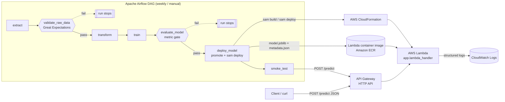

# Serverless Model Deployment & Pipeline Orchestration on AWS

**Module:** DAM405 Machine Learning Operations, Programming Assignment 4
**Student:** _<name, student number>_
**Repository:** _<link to repository>_
**Environment used:** _<"AWS SAM local (Docker emulation)" and/or "AWS account, region ap-south-1">_

---

## 1. Introduction

**Problem.** Fine-needle aspirate (FNA) measurements of a breast mass can indicate whether a tumour is malignant or benign. A model only helps clinicians if it is reachable on demand, is retrained in a controlled way, and is never deployed from bad data. This assignment therefore focuses on *operationalising* a model, not on squeezing out the last percent of accuracy.

**Dataset.** The Breast Cancer Wisconsin (Diagnostic) dataset has 569 samples and 30 numeric features (mean, standard error and "worst" value of 10 cell-nucleus measurements). The label is binary: 212 malignant and 357 benign. It ships with scikit-learn, so the extract step needs no network access or credentials.

**Approach.**
1. Wrap the ML lifecycle in an **Apache Airflow DAG** with two quality gates: a Great Expectations gate on data and a metric gate on the model.
2. Package the approved model in a **container-image AWS Lambda function** behind **API Gateway (HTTP API)**.
3. Define all cloud resources as code in an **AWS SAM** template.

## 2. Architecture

> If the submission format does not render Mermaid, paste the block into https://mermaid.live and export a PNG.

## 3. Serverless design

### 3.1 Handler (`lambda/app.py`)
* **Model loading at init.** The model and its metadata are loaded **at module import**, during the Lambda init phase, so the cost is paid once per execution environment. Warm invocations reuse it. The handler reports `cold_start` and `inference_ms` in every response.
* **Input handling.** The handler accepts a direct invocation, an API Gateway proxy event (including base64 bodies), a single record (`features`) or a batch (`instances`, capped by `MAX_BATCH_SIZE`).
* **Input validation.** Feature order is taken from `metadata.json`, not from the caller. Missing, non-numeric, NaN or infinite values return **HTTP 400** with a clear message instead of a 500 error.
* **Output.** The response gives the predicted label and both class probabilities. A JSON log line per request (model version, labels, latency, cold start) can be queried in CloudWatch Logs Insights.

### 3.2 Trigger
The function is exposed through an **API Gateway HTTP API** route `POST /predict`, defined as a SAM `HttpApi` event. An HTTP API was chosen over a REST API because it is cheaper and has lower latency, and this service needs none of the REST-only features (usage plans, request validation).

### 3.3 Deployment as code (`template.yaml`, `samconfig.toml`)

| Decision | Why |
|---|---|
| `PackageType: Image` | scikit-learn + SciPy + NumPy exceed Lambda's 250 MB unzipped zip limit, while images may be up to 10 GB. |
| `arm64` (Graviton) | Roughly 20% lower price per GB-second, and the image builds natively on Apple-silicon Macs. |
| `MemorySize: 1024` | Lambda allocates CPU in proportion to memory, so more memory shortens model load (cold start). |
| Explicit `LogGroup` with 14-day retention | Controls log storage cost. Without it, logs are kept forever. |
| `resolve_image_repos` | SAM creates and manages the ECR repository, so no manual setup is needed. |
| No credentials in the template | `sam deploy` uses the caller's AWS profile, and the IAM role is generated with least privilege. |

## 4. Airflow DAG (`dags/breast_cancer_pipeline.py`)

| Task | Does | Output |
|---|---|---|
| `extract` | Loads the source dataset and lands it unchanged | `data/<run_id>/raw.csv` |
| `validate_raw_data` | **Great Expectations gate** (see below) | `quality_report.json` |
| `transform` | Renames columns to API feature names, de-duplicates, makes a stratified 80/20 split | `train.csv`, `test.csv` |
| `train` | Fits `StandardScaler + LogisticRegression` as one sklearn `Pipeline` | `artifacts/<run_id>/model.joblib`, `model_card.json` |
| `evaluate_model` | **Model gate**: accuracy, ROC-AUC and malignant recall must reach thresholds | `metrics.json` |
| `deploy_model` | Atomically promotes the model into `lambda/model/`, then optionally runs `sam build && sam deploy` | serving dir |
| `smoke_test` | POSTs a known request to the endpoint and checks predictions come back | response |

**Data-quality gate.** The gate runs 65 expectations (GX Core 1.x):
* The column set matches the data contract (`pipeline/schema.py`) exactly.
* The row count is between 500 and 100 000.
* The target is not null and is in {0, 1}.
* The benign share is between 0.3 and 0.8, which catches a broken or one-sided feed.
* Each of the 30 features is not null and is ≥ 0.

On failure the task writes its report and then raises `AirflowFailException`. That skips retries, because bad data will not fix itself, and marks all downstream tasks *upstream_failed*, so a model is never trained on that data.

**Why a second gate on the model?** Clean data can still produce a weak model. *Malignant recall* is gated separately because a false negative (a missed cancer) is far more costly than a false positive.

**Best practice applied.**
* **Idempotent:** every output path is keyed by the DAG `run_id`, and the split uses a fixed random seed. Re-running a task gives the same files, which a unit test checks.
* **Atomic:** one responsibility per task. Every file is written to a temp file and then renamed (`pipeline/storage.py`), so a crash never leaves half a file.
* **Small XComs:** only file paths and metrics move between tasks, never DataFrames.
* **No secrets or hard-coded config:** thresholds, the deploy toggle and the endpoint URL are Airflow Variables, read through Jinja at run time rather than at parse time. AWS credentials come from the worker's profile.
* **Fast DAG parsing:** heavy libraries are imported inside tasks. The DAG uses `catchup=False` and `max_active_runs=1`.
* **Testability:** the stage logic lives in `pipeline/` and is unit-tested without Airflow (`tests/`).

## 5. AWS services and their MLOps roles

| AWS service | Used / emulated | MLOps role |
|---|---|---|
| AWS Lambda | _<used / emulated by SAM local>_ | Model serving (online inference) |
| Amazon API Gateway (HTTP API) | _<…>_ | Secure HTTPS endpoint, request routing, throttling |
| Amazon ECR | _<…>_ | Versioned registry for the inference image (serving artifact) |
| AWS SAM / CloudFormation | _<…>_ | Infrastructure as Code; repeatable, reviewable deployments; rollback |
| Amazon CloudWatch Logs / Metrics | _<…>_ | Monitoring: latency, errors, cold starts, prediction logging |
| AWS IAM | _<…>_ | Least-privilege execution role; no keys in code |
| Amazon S3 (SAM deploy bucket) | _<…>_ | Deployment artifact storage. A natural next step is a model registry. |
| *(Apache Airflow, local; on AWS: Amazon MWAA)* | local | Orchestration of the data + training + deployment pipeline |

## 6. Serverless trade-off analysis

**Cost.** Lambda bills per request and per GB-second, and is free when idle. For bursty or low traffic, like a clinical decision-support tool used a few thousand times a day, this is far cheaper than an always-on EC2 instance or SageMaker endpoint. *Illustration:* 100 000 requests/month × 100 ms × 1 GB on arm64 ≈ 8 000 GB-s, which is inside the monthly free tier. At high, steady throughput the per-request price overtakes a provisioned instance, and a container or SageMaker endpoint becomes cheaper.

**Cold starts.** A new execution environment must pull the image, start Python, import NumPy/SciPy/scikit-learn and unpickle the model. Measured result: cold start _<Init Duration from logs>_ ms vs warm _<Duration>_ ms (Section 7). Mitigations:
* a small model and image;
* more memory, which gives more CPU;
* Provisioned Concurrency or SnapStart for Python, which remove cold starts for a fixed fee and so give back part of the cost advantage;
* keeping the model load outside the handler, as done here.

**Scaling.** Lambda scales out automatically, one environment per concurrent request, up to the account concurrency limit, with no capacity planning. The limits:
* Every scale-out event is itself a cold start.
* Resources are capped at 10 GB memory, 6 vCPU and a 15-minute timeout, and there is **no GPU**. Lambda therefore suits small classical models like this one, but not large deep-learning or LLM inference.
* Downstream systems must cope with sudden bursts.

**Other trade-offs.** The provider manages patching and high availability, which reduces operational burden. In exchange there is vendor lock-in, a 6 MB request payload limit, and harder local debugging, which SAM local partly solves.

**Future trend: serverless GPU and LLMOps.** Inference is moving towards "serverless GPU" platforms (for example, SageMaker Serverless Inference, Bedrock-style managed foundation-model endpoints, and GPU function platforms). The pay-per-use model shown here is being extended to large models, and the cold-start problem is shifting from "import scikit-learn" to "load gigabytes of weights". MLOps pipelines like this DAG are growing evaluation gates for LLM-specific risks (hallucination, toxicity, prompt-injection tests), alongside the classic accuracy gates used here.

## 7. Results and evidence

### 7.1 Tests
📸 _<pytest output: N passed>_

### 7.2 Model metrics (hold-out set, n = 114)

| Metric | Value | Threshold |
|---|---|---|
| Accuracy | _<from metrics.json>_ | 0.93 |
| ROC-AUC | _<…>_ | 0.97 |
| Malignant recall | _<…>_ | 0.90 |
| Confusion matrix | _<…>_ | |

### 7.3 Serverless invocation
📸 _<`sam local invoke` output / curl response>_
📸 _<REPORT line with Init Duration (cold) and a second warm invocation>_

| Invocation | Duration (ms) | Init duration (ms) |
|---|---|---|
| 1st (cold) | _<…>_ | _<…>_ |
| 2nd (warm) | _<…>_ | — |

### 7.4 Airflow DAG runs
📸 _<Graph view: successful run, all green>_
📸 _<Graph view: inject_bad_data run, validate_raw_data failed, downstream upstream_failed>_
📸 _<validate_raw_data log listing failed expectations>_

**Discussion.** _<2–4 sentences. What the metrics show; that the gate blocked bad data before any training; how big the cold-start penalty was compared with warm latency, and what that means for the cost/latency trade-off.>_

## 8. Limitations and future work
* **Static dataset.** The extract reads a bundled dataset. In production it would read new labelled data from S3 or a database through an Airflow Connection.
* **Model in the image.** Every new model needs a new image. Loading the model from an S3 model registry (or SageMaker Model Registry) by version would decouple model and code, and enable instant rollback.
* **No production monitoring loop.** Prediction logs are collected but not analysed. Next steps: data-drift detection (e.g. Evidently) on logged inputs, and CloudWatch alarms on error rate and latency.
* **Unauthenticated endpoint.** The API should get IAM or JWT authorisation, throttling and a WAF before handling real patient data.
* **Local Airflow.** `airflow standalone` with SQLite is for development only. Production would use Amazon MWAA or a containerised deployment, with CI (GitHub Actions) running the tests and `sam validate` on every push.
* **Simple model.** Logistic regression was chosen for interpretability and a small cold-start footprint. Hyper-parameter tuning and experiment tracking (MLflow) are natural additions.

## 9. References
* Gift, N. & Deza, A. (2021). *Practical MLOps*. O'Reilly.
* Wolberg, W., Mangasarian, O., Street, N. & Street, W. (1995). *Breast Cancer Wisconsin (Diagnostic)*. UCI Machine Learning Repository.
* AWS (2026). *AWS Lambda Developer Guide*; *AWS SAM Developer Guide*. https://docs.aws.amazon.com
* Apache Software Foundation (2026). *Apache Airflow documentation*. https://airflow.apache.org/docs
* Great Expectations (2026). *GX Core documentation*. https://docs.greatexpectations.io
* Pedregosa, F. et al. (2011). Scikit-learn: Machine Learning in Python. *JMLR* 12, 2825–2830.

## 10. AI-use declaration
_<State, per module/institutional policy, which AI tools were used and for what. For example: "Claude (Anthropic) was used to help scaffold the code and draft sections of this report. I reviewed, ran and tested all code and edited the text.">_
